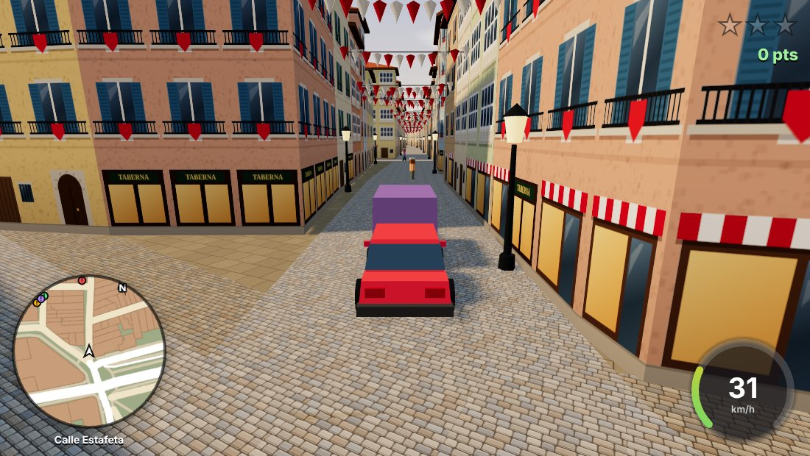
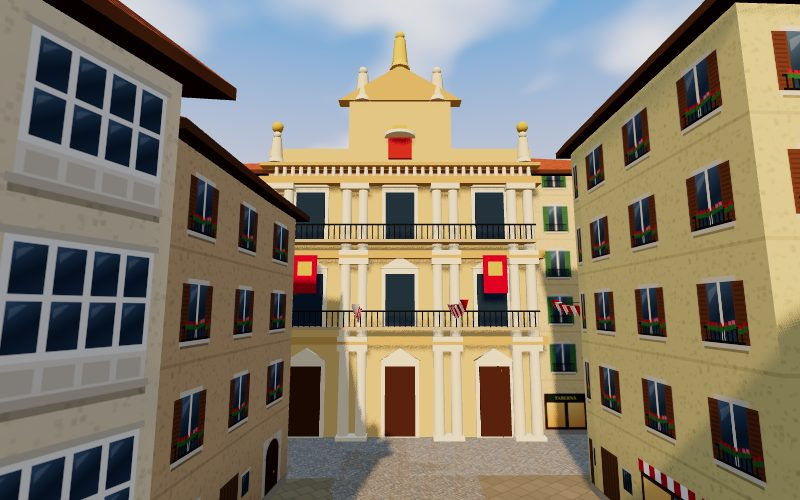
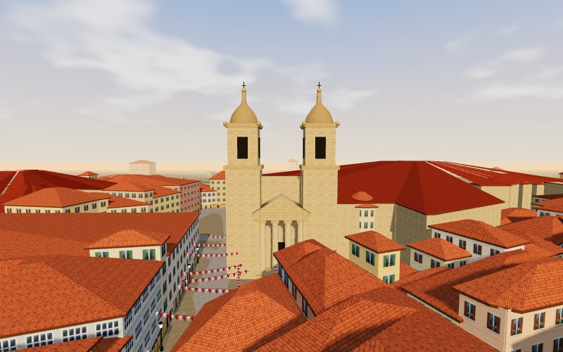
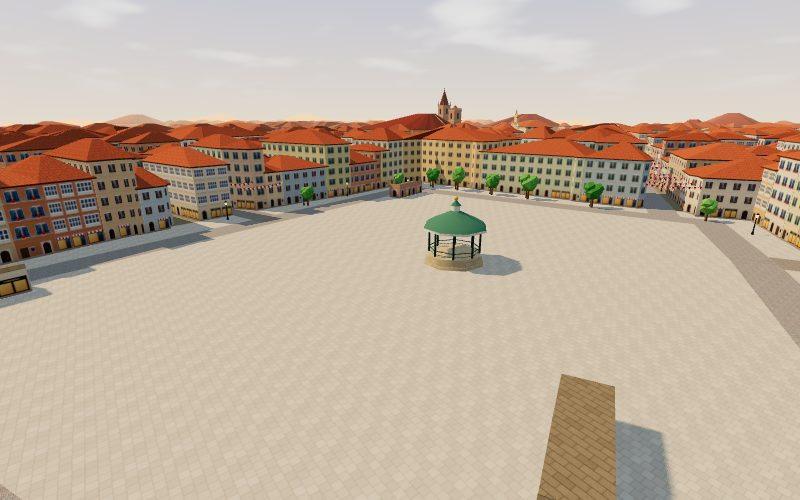

# Casco Viejo Rush

Juego de navegador **original** de acción en mundo abierto, en clave cartoon, por las calles reales del **Casco Viejo de Pamplona**. Robas un coche "prestado", haces recados contrarreloj, persigues a un ladrón de txapelas, compites en una carrera junto a las murallas e intentas despistar a la policía por calles de 4 metros de ancho.

Está hecho con **Three.js** + **Vite**, en 3D low-poly con cámara en tercera persona, y el mapa sale de **OpenStreetMap**.



| Ayuntamiento | Catedral de Santa María | Plaza del Castillo |
| --- | --- | --- |
|  |  |  |

> Proyecto original sin relación con ninguna franquicia comercial: nombre, interfaz, modelos y sonidos están hechos para este juego (modelos generados por código y sonido sintetizado con WebAudio, sin assets externos).

## Cómo ejecutarlo

Necesitas **Node.js 20 o superior** (probado con Node 22).

```bash
npm install
npm run dev        # servidor de desarrollo → http://localhost:5173
```

Para generar la versión estática:

```bash
npm run build      # genera la carpeta dist/
npm run preview    # sirve dist/ en http://localhost:4173
```

La carpeta `dist/` se puede subir a cualquier hosting estático (usa rutas relativas).

### Publicar en GitHub Pages

El repositorio incluye el workflow `.github/workflows/deploy.yml`, que compila y publica el juego en cada push a `main`.

**Hay que activarlo una vez:** en GitHub ve a **Settings → Pages → Build and deployment → Source** y elige **GitHub Actions**. Tras el siguiente push (o lanzando el workflow a mano desde la pestaña *Actions*), el juego quedará en `https://<usuario>.github.io/<repositorio>/`.

## Controles

| Acción | Teclado / ratón |
| --- | --- |
| Moverse / conducir | `W` `A` `S` `D` o flechas |
| Cámara | Ratón (haz clic en el juego para capturarlo; `Esc` lo libera y pausa) |
| Entrar / salir del coche | `E` |
| Freno de mano (derrapes) | `Espacio` |
| Correr (a pie) | `Shift` |
| Mapa grande | `M` |
| Recolocar el coche en la calle (si te atascas) | `R` |
| Abandonar la misión | `X` |
| Pausa y ayuda | `H` |
| Activar / silenciar sonido | `N` |
| Calidad alta / rendimiento | `Q` |
| Contador de FPS | `F` |

**Pantallas táctiles:** aparece un joystick virtual (izquierda), botones `E`, `Freno` y `Mapa` (derecha) y se arrastra el dedo sobre la escena para girar la cámara. Es un control básico; el juego está pensado sobre todo para teclado y ratón.

## Cómo se juega

- **A pie** puedes pasear, correr y subirte a cualquier coche cercano con `E`. Los aparcados son gratis; si sacas a un conductor de su coche, la policía te buscará (1 estrella). Llevarte un coche patrulla son 2 estrellas.
- **Conducción arcade:** aceleración rápida, derrapes con el freno de mano, choques con fachadas, coches y mobiliario.
- **Peatones y tráfico** circulan por el grafo real de calles. Los peatones esquivan saltando y, si los golpeas, salen dando volteretas de dibujos animados, se levantan y huyen (sin violencia gráfica).
- **Nivel de búsqueda (1–3 estrellas):** atropellar peatones, robar coches o embestir patrullas sube el nivel. Las patrullas te persiguen calculando rutas por las calles. Para **despistarlas** tienes que salir de su campo de visión: mientras ninguna te vea, las estrellas parpadean y se llena la barra "Despistando…"; al completarse bajas una estrella. Si te quedas parado junto a una patrulla, te detienen y vuelves a la Plaza del Castillo.
- **Misiones** (círculos de colores en el mundo y en el minimapa; hay que entrar con un coche):

| Misión | Tipo | Dónde empieza |
| --- | --- | --- |
| **El Encierro** | Contrarreloj: Ayuntamiento → Mercaderes → Estafeta → Plaza de Toros | Santo Domingo |
| **Reparto de txistorra** | Contrarreloj: Plaza del Castillo → Navarrería → Catedral | Calle Mayor |
| **El ladrón de txapelas** | Persecución: embiste 3 veces la furgoneta del ladrón | Plaza del Castillo |
| **Carrera de las murallas** | Carrera contra dos rivales con 5 controles | Taconera |
| **Fuga por la Navarrería** | Empiezas con 2 estrellas: despista a la policía antes de 2:30 | Catedral |

Las misiones superadas se guardan en el navegador y suman puntos.

## Mapa y datos (OpenStreetMap)

El mapa se genera a partir de datos reales de OpenStreetMap obtenidos con la **Overpass API**:

- Calles (con su tipo y nombre, preferentemente en castellano), huellas de edificios, plazas, parques y murallas del Casco Antiguo, guardados en [`data/casco-viejo.json`](data/casco-viejo.json).
- Los edificios se extruyen a **3–5 plantas** (se usa `building:levels` cuando existe, si no una altura variable).
- Las calles del Casco Viejo conservan su trazado real pero se **ensanchan un poco** (unos 6,8 m entre fachadas) apartando las fachadas que invaden la calzada, para que los coches no se atasquen en la Estafeta, la Calle Mayor o la Navarrería.

### Aspecto visual

Todo se genera por código (texturas en *canvas* y modelos con primitivas), sin imágenes externas:

- **Fachadas pamplonesas:** cada edificio tiene su color (ocres, cremas, almagres, azulados…) y una combinación de plantas altas con **miradores acristalados**, **balcones de forja**, contraventanas verdes, marrones o azules, **geranios** y pañuelos rojos. Las plantas bajas mezclan **comercios con toldo**, **tabernas**, **portales de piedra con arco** y portones de madera. El revoco se tiñe y los detalles (madera, cristal, hierro, piedra) conservan su color.
- **Tejados de teja árabe a cuatro aguas** con **aleros de madera**.
- **Adoquinado de granito** en las calles del Casco Viejo, losas en las plazas, asfalto en las avenidas, césped en los parques y **sillería de piedra** en iglesias, baluartes y murallas.
- **Hitos detallados:**
  - **Ayuntamiento:** fachada barroca de tres cuerpos con columnas, balcones corridos, balaustrada, frontón con reloj y estatuas.
  - **Catedral de Santa María:** fachada neoclásica con pórtico de columnas y frontón, y las dos torres-campanario con remate en forma de campana.
  - **San Saturnino:** torres de ladrillo, una con aguja y pináculos, y relojes.
  - **San Nicolás:** torre almenada.
  - **Plaza del Castillo:** kiosco con cúpula verde, arbolado y terrazas con sombrillas.
  - **Navarrería:** fuente de Santa Cecilia.
  - Además: garitas en las puntas de los baluartes, el Monumento a los Fueros, portales y murallas.
- **Ambiente festivo:** banderines rojos y blancos cruzando la Estafeta, Mercaderes, Calle Mayor, San Nicolás y alrededores, y **farolas fernandinas** junto a las fachadas.
- **Luz de tarde dorada**, cielo con degradado, halo del sol y nubes, niebla cálida y *tone mapping* ACES.
- En el menú, una **presentación** recorre el Ayuntamiento, la Plaza del Castillo, la Catedral, San Saturnino y la Estafeta.

Para volver a descargar los datos:

```bash
npm run fetch-osm
# detrás de un proxy HTTP (Node >= 22.21):
NODE_USE_ENV_PROXY=1 npm run fetch-osm
```

El script (`scripts/fetch-osm.mjs`) prueba varios servidores Overpass públicos y simplifica la respuesta al formato que usa el juego.

## Rendimiento

Pensado para ir a 60 fps en un portátil normal:

- Los edificios se **fusionan por sectores de 200 × 200 m** (fachadas, piedra, tejados y aleros: 4 mallas por sector), lo que reduce la ciudad a unas pocas decenas de *draw calls* y permite **frustum culling** por sector. Las fachadas usan un único atlas de texturas con un *shader* que elige la variante de cada edificio.
- Árboles, farolas, banderines y terrazas usan **instancing**.
- **Niebla y plano lejano** recortan lo que queda lejos.
- Las colisiones y la línea de visión de la policía usan una rejilla espacial 2D de segmentos (sin física 3D).
- Sombras con un único mapa que sigue al jugador. Si el juego detecta que va por debajo de 40 fps, baja automáticamente a modo rendimiento (sin sombras y resolución 1×); también se puede alternar con `Q`.

## Estructura

```
data/casco-viejo.json     Datos OSM simplificados
scripts/fetch-osm.mjs     Descarga desde Overpass API
src/main.js               Bucle principal, jugador, coches, eventos
src/world/city.js         Ciudad: extrusión, ensanche de calles, tejados, suelos, murallas
src/world/textures.js     Texturas procedurales (fachadas, teja, adoquín, piedra...) y shader de fachada
src/world/monuments.js    Ayuntamiento, Catedral, San Saturnino, San Nicolás, kiosco, garitas...
src/world/landmarks.js    Zonas con nombre, banderines, farolas, terrazas, árboles
src/world/                Además: colisiones y grafo de calles (A*)
src/entities/             Coches (física arcade) y personas
src/systems/              Tráfico y peatones, policía, misiones
src/ui/hud.js             Minimapa, mapa grande, velocímetro, estrellas, textos
src/camera.js             Cámara en tercera persona con colisión
src/input.js, audio.js    Controles (teclado/ratón/táctil) y sonido sintetizado
```

## Qué falta / ideas

- El táctil es básico (sin vibración ni ajuste de sensibilidad).
- Los coches no se dañan ni vuelcan; `R` los recoloca si se atascan.
- Los tejados son una aproximación (cuatro aguas sobre la planta real) y no hay interiores.
- El tráfico no respeta semáforos ni sentidos de circulación (en el Casco Viejo casi todo es peatonal).

## Atribución y licencias

- Datos del mapa: **© OpenStreetMap contributors**, disponibles bajo la licencia **Open Database License (ODbL) 1.0** — <https://www.openstreetmap.org/copyright>. El archivo `data/casco-viejo.json` es una base de datos derivada y se distribuye bajo ODbL.
- Three.js © autores de three.js (licencia MIT).
- Código del juego: MIT.
